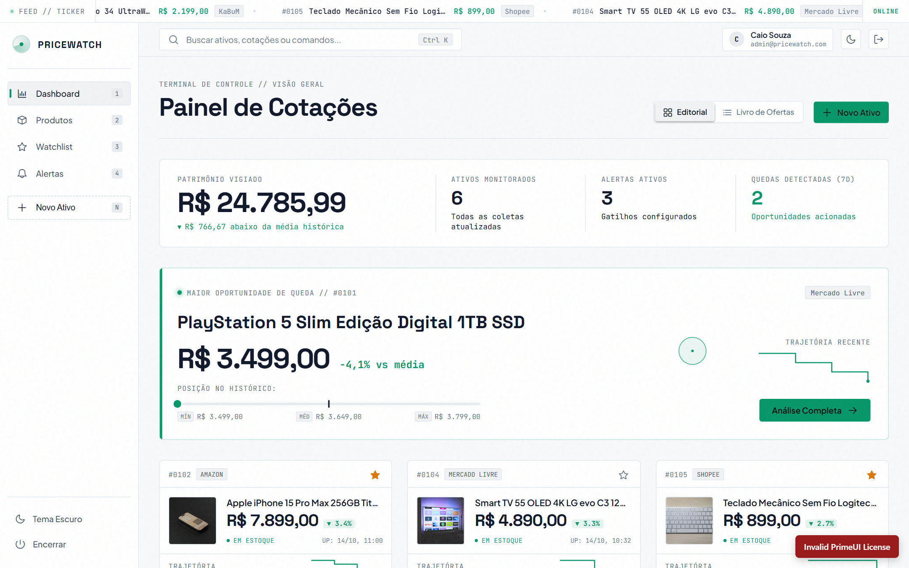
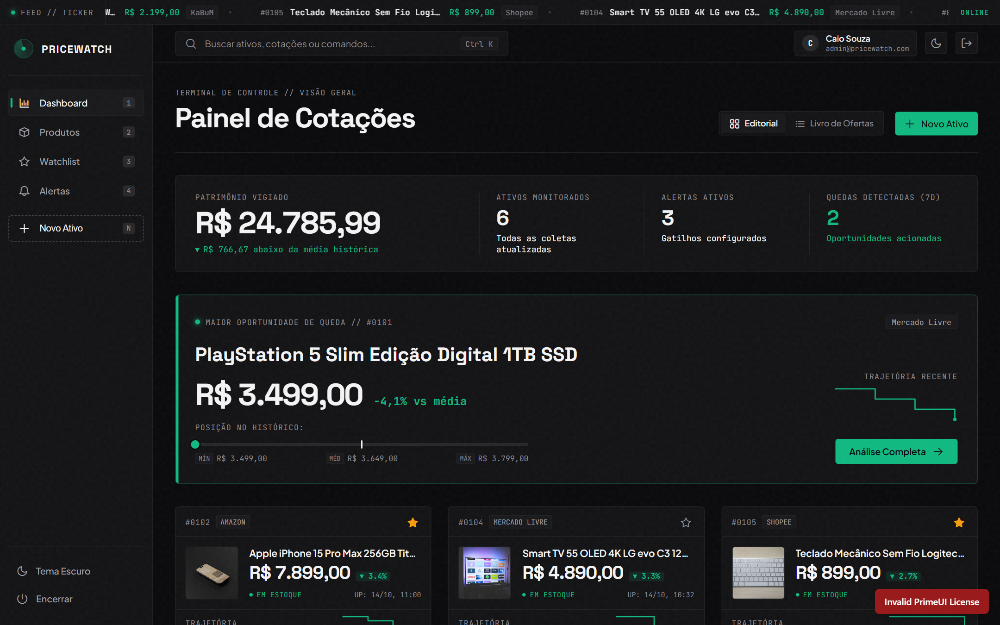
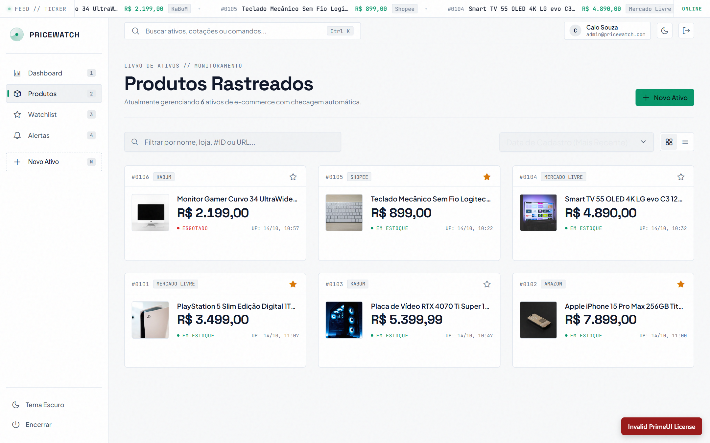
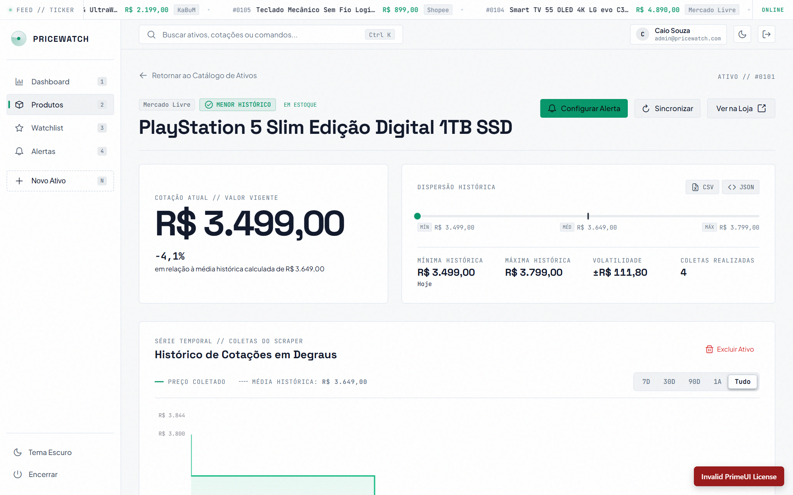
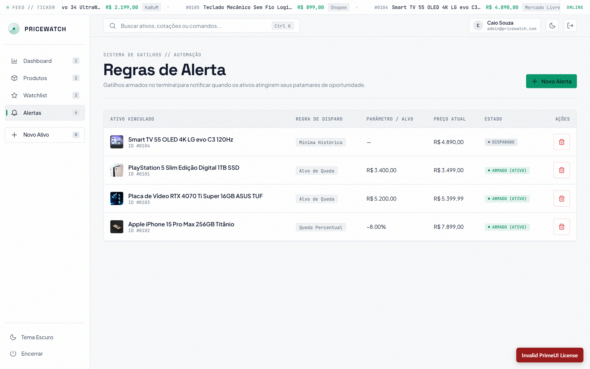
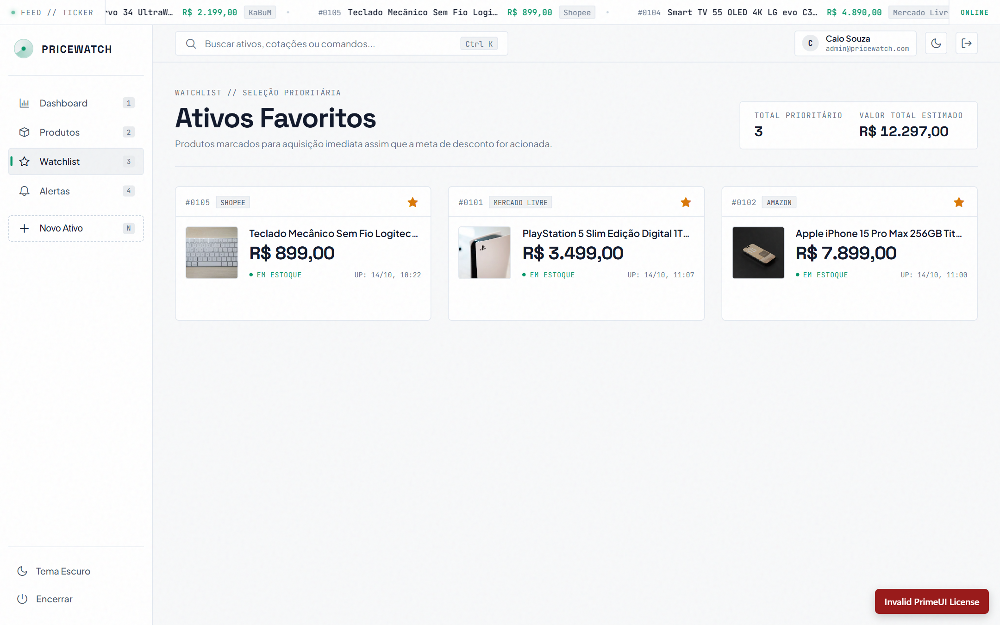
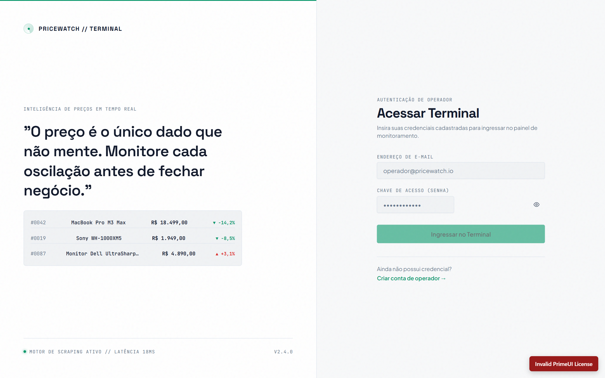
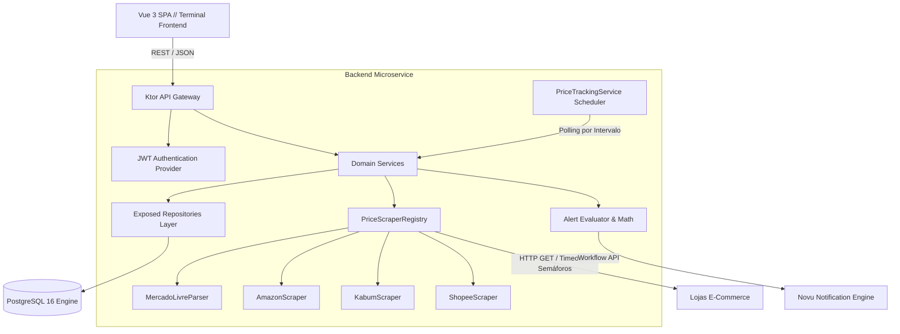
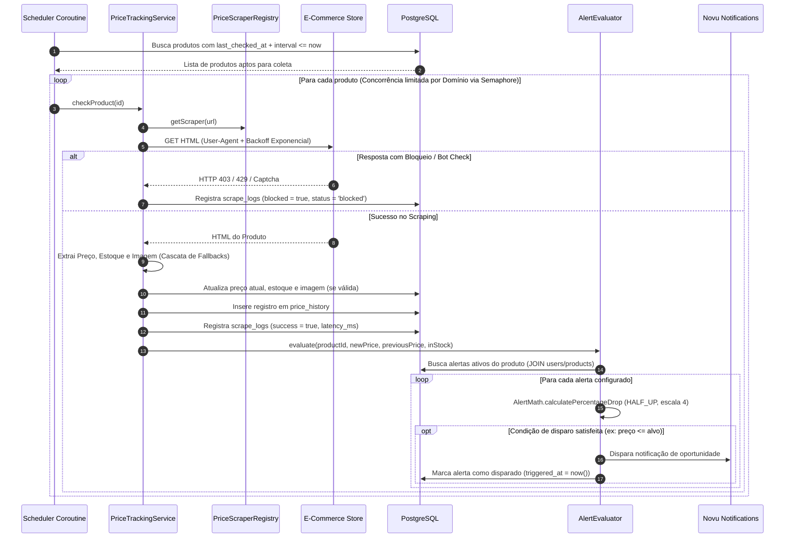
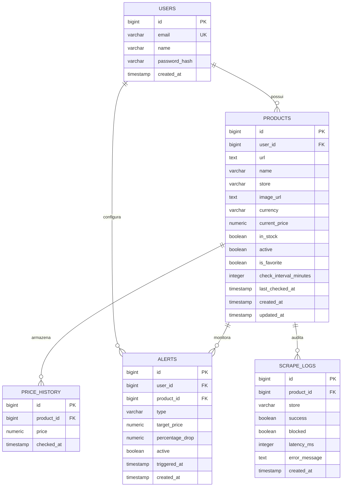

# PriceWatch // Terminal de Inteligência de Preços

> Plataforma full-stack de monitoramento contínuo de preços, coleta automatizada resiliente em e-commerces e avaliação de gatilhos de alerta em tempo real.


---

## 📸 Telas do Sistema e Funcionalidades

O frontend do **PriceWatch** foi concebido com uma linguagem visual editorial e minimalista inspirada em terminais financeiros de alta precisão (Dark/Light mode, tipografia monoespaçada técnica, gráficos em degraus e microinterações reativas).

---

### 1. Painel de Cotações (Dashboard Principal)


#### O que esta tela faz:
- **Visão Geral e KPIs Consolidados:** Exibe métricas vitais em tempo real:
  - **Patrimônio Vigiado:** Soma dos valores de todos os produtos ativos monitorados e a economia calculada em relação à média histórica.
  - **Ativos Monitorados:** Quantidade total de produtos cadastrados com status da última coleta.
  - **Alertas Ativos:** Total de gatilhos armados no sistema prontos para notificação.
  - **Quedas Detectadas (7D):** Oportunidades de compra identificadas nos últimos 7 dias.
- **Destaque da Maior Oportunidade (Hero Card):** Apresenta o produto com maior variação percentual negativa em relação ao histórico médio, acompanhado de:
  - Barra de posição de preço (`Mínimo`, `Médio`, `Máximo`).
  - Mini gráfico *sparkline* da trajetória recente das coletas.
  - Acesso direto à análise detalhada do ativo.
- **Grid de Ativos em Tempo Real:** Cards individuais com logotipo/identificação da loja (Mercado Livre, Amazon, KaBuM, Shopee), badge de estoque, cotação atual e mini gráfico em degraus.

---

### 2. Terminal em Modo Escuro (Dark Mode)


#### O que esta tela faz:
- **Alternância de Tema Fluida:** Suporte completo a tema escuro profundo (`#0d1117` / `#161b22`) com realce em verde esmeralda (`#10b981`).
- **Persistência de Preferência:** Salva a escolha do usuário no `localStorage` e respeita a preferência de sistema do sistema operacional (`prefers-color-scheme`).
- **Ergonomia Visual:** Reduz a fadiga visual para operadores de monitoramento e sessões prolongadas de análise de mercado.

---

### 3. Catálogo de Produtos Rastreados (Livro de Ativos)


#### O que esta tela faz:
- **Gerenciamento do Portfólio de Produtos:** Listagem completa de todos os itens cadastrados pelo usuário autenticado.
- **Filtros Dinâmicos no Banco de Dados (Exposed SQL):**
  - **Filtro por Loja:** Segmentação por Mercado Livre, Amazon, KaBuM e Shopee.
  - **Filtro por Estoque:** Visualização rápida de itens disponíveis ou esgotados.
  - **Filtro de Rastreamento:** Separação entre produtos ativos e pausados (`active`/`paused`).
  - **Filtro de Favoritos:** Exibição exclusiva de produtos favoritados com a estrela dourada.
- **Cadastro Rápido de Novo Ativo:** Modal integrado com suporte a detecção automática da loja, validação de URL e definição do **intervalo individual de checagem** (de 15 minutos até 24 horas).
- **Alternância de Visualização:** Suporte a grid de cards e tabela densa estilo terminal de ordens.

---

### 4. Análise Detalhada do Ativo & Histórico de Cotações


#### O que esta tela faz:
- **Análise Estatística da Dispersão Histórica:**
  - Identificação imediata da **Cotação Atual**, **Mínima Histórica**, **Preço Médio**, **Máxima Histórica** e **Volatilidade (Desvio)**.
  - Indicador de oportunidade quando o preço atual coincide com o menor patamar já registrado (`MENOR HISTÓRICO`).
  - Total de coletas realizadas pelo motor de scraping.
- **Gráfico Temporal de Coletas em Degraus (Step Chart):**
  - Gráfico de série temporal renderizado via Chart.js demonstrando com precisão os momentos exatos em que ocorreram variações de preço.
  - Linha de referência da média histórica ponderada.
  - Filtro de período temporal (`7D`, `30D`, `90D`, `1A`, `Tudo`).
- **Exportação de Dados (CSV e JSON):**
  - **Exportar CSV:** Download direto com cabeçalho `id,productId,price,checkedAt`, escaping padrão RFC 4180 e cabeçalho HTTP `Content-Disposition: attachment; filename="product_{id}_history.csv"`.
  - **Exportar JSON:** Payload estruturado completo da série histórica.
- **Ações Rápidas:** Botões para disparar coleta manual instantânea (`Sincronizar`), abrir a página oficial na loja (`Ver na Loja`), configurar regras de alerta e exclusão do ativo.

---

### 5. Central de Regras de Alerta (Automação de Gatilhos)


#### O que esta tela faz:
- **Painel de Gatilhos Armados:** Centraliza todos os alertas configurados pelo usuário com associação clara ao produto correspondente (nome do produto e imagem extraída).
- **Tipos de Regras Suportadas:**
  - **Alvo de Preço (`PRICE_BELOW`):** Dispara notificação imediata quando o preço atinge ou fica abaixo do valor especificado (ex: R$ 3.400,00).
  - **Queda Percentual (`PERCENTAGE_DROP`):** Dispara quando ocorre uma redução percentual brusca em relação à checagem anterior (ex: queda ≥ 8%).
  - **Mínima Histórica (`HISTORICAL_MIN`):** Alerta quando o produto atinge o menor valor de toda a sua série histórica.
  - **Retorno ao Estoque (`BACK_IN_STOCK`):** Notifica quando um produto esgotado volta a ficar disponível.
- **Gerenciamento de Ciclo de Vida dos Alertas:**
  - **Edição Sem Recriação (`PUT /alerts/{id}`):** Permite alterar alvos e limites sem perder a entidade.
  - **Reativação Inteligente (`PATCH /alerts/{id}/toggle`):** Reativar um alerta que já havia sido disparado limpa automaticamente o estado `triggered_at`, recolocando-o na esteira de monitoramento ativo.
  - Indicadores de estado visual: `ARMADO (ATIVO)`, `DISPARADO` e `INATIVO`.

---

### 6. Watchlist (Ativos Prioritários)


#### O que esta tela faz:
- **Painel de Foco para Compras Imediatas:** Exibe exclusivamente os produtos marcados como favoritos pelo usuário.
- **Resumo Financeiro de Aquisição:** Calcula automaticamente o **Valor Total Estimado** necessário para arrematar todos os produtos favoritados.
- **Acesso Imediato à Variação Recente:** Monitoramento dedicado dos itens mais críticos da lista de desejos.

---

### 7. Acesso ao Terminal (Autenticação de Operador)


#### O que esta tela faz:
- **Login Seguro via JWT:** Autenticação stateless baseada em e-mail e senha com validação de formato e hash criptográfico BCrypt.
- **Criação de Conta:** Tela de cadastro de novos operadores com geração imediata de token e redirecionamento seguro (`safeRedirect`).
- **Ticker de Mercado em Tempo Real:** Exibe cotações ao vivo no rodapé do terminal demonstrando a atividade do motor de scraping.

---

## 🛠️ Stack Tecnológica

| Camada | Tecnologia | Descrição e Finalidade |
|---|---|---|
| **Linguagem Backend** | Kotlin 2.0 | Tipagem estrita, performance JVM e Coroutines nativas para I/O assíncrono. |
| **Framework Web** | Ktor 2.3 | Servidor HTTP assíncrono leve com Netty, Content Negotiation e autenticação JWT. |
| **Banco de Dados** | PostgreSQL 16 | Banco relacional para séries temporais de preços, índices compostos e integridade referencial. |
| **ORM** | Exposed 0.49 | SQL DSL fortemente tipado do ecossistema Kotlin com suporte a queries dinâmicas. |
| **Migrations** | Flyway | Versionamento estrito de esquema (`V1` a `V7`), garantindo migrações determinísticas. |
| **Scraping Engine** | Jsoup + Ktor Client | Requisições HTTP com User-Agent configurável, backoff exponencial e parsing DOM resiliente. |
| **Notificações** | Novu | Orquestração multi-canal (e-mail, push, webhooks) disparada no fechamento de gatilhos. |
| **Frontend SPA** | Vue 3 + TypeScript | Interface reativa orientada a componentes com Vite e Pinia. |
| **Gráficos** | Chart.js | Visualização de séries históricas de preços com interpolação em degraus. |
| **Infraestrutura** | Docker Compose | Orquestração de contêineres (`db`, `backend`, `frontend`) com healthchecks integrados. |

---

## 🏗️ Arquitetura do Sistema



---

## 🔄 Fluxo de Coleta e Avaliação de Alertas



---

## 🗄️ Modelo de Dados (Flyway Versioning)

O schema do banco de dados é 100% versionado através de migrations Flyway:

- `V1`: Tabelas base de `users`, `products`, `price_history` e `alerts`.
- `V2`: Índices de performance para séries temporais e chaves estrangeiras.
- `V3`: Auditoria e logs operacionais de scraping (`scrape_logs`).
- `V4`: Novas regras de alerta (quedas percentuais e menor histórico).
- `V5`: Indicador de favoritos (`is_favorite`) e integridade de estoque.
- `V6__product_interval_and_checks.sql`: Intervalo individual de coleta (`check_interval_minutes` entre 15 e 1440 min) e timestamp de última verificação (`last_checked_at`), com índice otimizado `idx_products_active_schedule`.
- `V7__scrape_logs_store_and_blocked.sql`: Observabilidade aprimorada com identificação da loja (`store`), flag de bloqueio anti-bot (`blocked`) e índices para agregações temporais.



---

## 📡 Referência Completa da API REST

Todas as rotas sob `/products`, `/alerts` e `/scraper` exigem o cabeçalho HTTP:
```http
Authorization: Bearer <seu_token_jwt>
```

| Método | Endpoint | Protegido | Parâmetros / Body | Descrição |
|---|---|---|---|---|
| `GET` | `/health` | **Não** | — | Healthcheck público sem autenticação para Docker e orquestradores (Kubernetes). |
| `POST` | `/auth/register` | **Não** | `{ "name": "...", "email": "...", "password": "..." }` | Criação de novo usuário com senha criptografada em BCrypt. |
| `POST` | `/auth/login` | **Não** | `{ "email": "...", "password": "..." }` | Autenticação com retorno de JWT assinado. |
| `GET` | `/products` | **Sim** | Query params opcionais:<br>`store`: "Amazon"<br>`inStock`: true/false<br>`tracking`: "active"/"paused"<br>`favorite`: true/false | Listagem dos produtos do usuário com filtros processados diretamente no SQL. |
| `POST` | `/products` | **Sim** | `{ "name": "...", "url": "...", "checkIntervalMinutes": 30 }` | Cadastra novo produto validando URL e intervalo (15 a 1440 min). |
| `GET` | `/products/{id}` | **Sim** | — | Retorna dados completos de um produto pertencente ao usuário autenticado. |
| `PUT` | `/products/{id}` | **Sim** | `{ "name": "...", "active": true, "checkIntervalMinutes": 45 }` | Atualiza dados e intervalo de checagem do produto. |
| `DELETE`| `/products/{id}` | **Sim** | — | Remove o produto e seus registros associados em cascata. |
| `PUT` | `/products/{id}/favorite` | **Sim** | — | Alterna o status de favorito (adiciona/remove da Watchlist). |
| `GET` | `/products/{id}/history` | **Sim** | — | Retorna a série histórica de preços coletada pelo scraper. |
| `GET` | `/products/{id}/history/export` | **Sim** | Query param `format`: `csv` ou `json` (padrão: `csv`) | Exportação com `Content-Disposition: attachment; filename="product_{id}_history.csv"` e escape RFC 4180. |
| `POST` | `/products/{id}/refresh` | **Sim** | — | Dispara uma coleta imediata sob demanda para o produto. |
| `GET` | `/alerts` | **Sim** | — | Retorna todos os alertas do usuário com JOIN das informações do produto (`productName`, `productImageUrl`). |
| `POST` | `/alerts` | **Sim** | `{ "productId": 101, "type": "PRICE_BELOW", "targetPrice": 3400.00 }` | Configura novo gatilho de alerta. |
| `PUT` | `/alerts/{id}` | **Sim** | `{ "targetPrice": 3350.00, "active": true }` | Edita os parâmetros do alerta sem recriá-lo. |
| `PATCH`| `/alerts/{id}/toggle` | **Sim** | — | Alterna ativo/inativo; reativar limpa `triggeredAt` para voltar a ser avaliado. |
| `DELETE`| `/alerts/{id}` | **Sim** | — | Remove a regra de alerta. |
| `GET` | `/scraper/stats` | **Sim** | Query params opcionais:<br>`store`: "KaBuM"<br>`window`: "24h" ou "7d" | Telemetria agregada: taxa de sucesso, latência média/p95, total de bloqueios e falhas recentes. |

---

## 🚀 Como Executar o Projeto Localmente

### Pré-requisitos
- [Docker](https://www.docker.com/) e Docker Compose instalados.
- *(Opcional para desenvolvimento nativo)*: JDK 21 e Node.js 20+.

### 1. Clonar o Repositório e Configurar Variáveis
```bash
git clone https://github.com/CaioSouzx00/pricewatch.git
cd pricewatch

# Copie o arquivo de variáveis de ambiente
cp .env.example .env
```

### 2. Inicialização Completa via Docker Compose
O Docker Compose constrói as imagens do backend (Kotlin/Gradle) e frontend (Vue 3/Vite), inicializa o banco PostgreSQL 16 e executa as migrations Flyway automaticamente:

```bash
docker compose up -d --build
```

Acompanhe os logs dos contêineres:
```bash
docker compose logs -f
```

### 3. Acessar os Serviços
- **Frontend SPA:** [http://localhost:5173](http://localhost:5173)
- **Backend API:** [http://localhost:8080](http://localhost:8080)
- **Healthcheck:** [http://localhost:8080/health](http://localhost:8080/health)

---

## 🧪 Suíte de Testes Automatizados

O backend conta com **51 testes automatizados** abrangendo testes unitários de parsers, cálculo de alertas puros e testes de integração de rotas com `testApplication` do Ktor:

```bash
# Execução dos testes via container Gradle (compatibilidade JDK 21 garantida):
docker run --rm \
  -v gradle_cache:/home/gradle/.gradle \
  -v "${PWD}/backend:/home/gradle/src" \
  -w /home/gradle/src \
  gradle:8.10-jdk21 gradle test
```

### Principais Casos Testados:
- **`AlertRulesTest`:** Precisão matemática em dízimas periódicas sem `ArithmeticException`, cálculo com divisor zero/negativo e correspondência de alvos (`PRICE_BELOW`, `PERCENTAGE_DROP`).
- **Parsers de Scraping (`MercadoLivre`, `Amazon`, `Kabum`, `Shopee`):** Extração de metatags `og:image`, JSON-LD Schema.org, payloads `__NEXT_DATA__`, seletores DOM de fallback e identificação de telas de bloqueio/CAPTCHA.
- **Rotas de API (`ProductRoutesTest`, `AlertsRoutesTest`, `ScrapingAndTelemetryRoutesTest`):** Validação de limites de intervalo (15 a 1440 min), isolamento multiusuário (prevenção de vazamento de dados), sanitização de CSV para exportação e isolamento do `/health` público.

---

## 🤝 Contribuição e Licença

1. Crie uma branch para sua funcionalidade (`git checkout -b feature/nova-funcionalidade`).
2. Realize o commit de suas alterações (`git commit -m 'feat: adiciona suporte a nova loja'`).
3. Envie para o repositório remoto (`git push origin feature/nova-funcionalidade`).
4. Abra um Pull Request detalhado.

Distribuído sob a licença **MIT**. Consulte `LICENSE` para mais informações.
